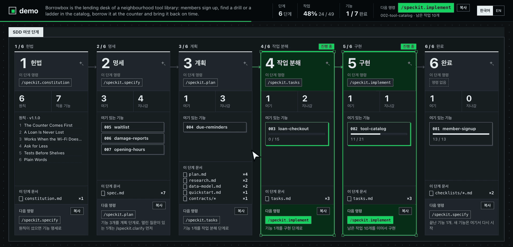

# spec-visualizer

[English](README.md) | 한국어 | [简体中文](README.zh-CN.md)

[GitHub spec-kit](https://github.com/github/spec-kit) 프로젝트를 보여 주는 로컬 읽기 전용 대시보드다.
스펙 주도 개발의 여섯 단계를 보드 하나에 펼치고, 어느 기능이 어느 단계에 있으며 다음에 무엇을 입력하면 되는지 보여 준다. 스펙 문서는 마크다운을 그대로 그리지 않고 문서 종류에 맞는 페이지로 보여 준다.

[OpenSpec](https://github.com/Fission-AI/OpenSpec)과 [Kiro](https://kiro.dev/docs/specs/) 프로젝트도 같은 보드에서 그 형식의 단계와 명령으로 보여 준다. [다른 형식](#다른-형식)을 본다.



## 설치

Node.js 20 이상이 필요하다.

```sh
npx spec-visualizer                          # 현재 폴더의 프로젝트
npx spec-visualizer --demo                   # 둘러볼 수 있는 spec-kit 예제 프로젝트
npx spec-visualizer --demo --format openspec # 같은 예제를 OpenSpec으로 쓴 것 (또는 --format kiro)
```

찾은 형식과 주소(기본값 `http://127.0.0.1:4321`)를 출력하고 브라우저에서 연다. 폴더에 `specs/`나 `.specify/`(spec-kit), `openspec/`(OpenSpec), `.kiro/specs/`나 `.kiro/steering/`(Kiro)가 있어야 한다.

### Claude Code 플러그인

플러그인은 Claude Code 세션에서 같은 대시보드를 시작하고, 열고, 멈춘다. Claude Code에서 다음을 입력한다.

```text
/plugin marketplace add josephleee/spec-visualizer
/plugin install spec-visualizer@spec-visualizer
```

셸에서는 `claude plugin install spec-visualizer --marketplace josephleee/spec-visualizer` 한 줄로 둘을 함께 한다.

그다음 spec-kit, OpenSpec, Kiro 프로젝트에서 `/spec-visualizer:dashboard`를 실행한다(멈출 때는 `/spec-visualizer:dashboard stop`). Claude에게 스펙 현황을 보여 달라고 해도 된다.

## 사용법

```sh
spec-visualizer [path] [options]
```

경로를 생략하면 현재 폴더를 쓴다. 파일이 바뀌면 화면이 스스로 갱신된다. 화면은 한국어와 영어를 지원하고(위쪽 띠 오른쪽의 전환 버튼), 시스템의 밝은 / 어두운 설정을 따른다.

| 옵션 | 기본값 | 뜻 |
|---|---|---|
| `--port <n>` | `4321` | 들을 포트. 이 옵션이 없으면 포트가 사용 중일 때 다음 빈 포트로 넘어간다(4330까지). 이 옵션을 주면 사용 중인 포트는 오류다. |
| `--format <이름>` | 찾은 형식 | 폴더를 `spec-kit`, `openspec`, `kiro` 가운데 하나로 읽는다. 없으면 폴더로 형식을 찾는다. 여러 형식이 함께 있으면 spec-kit, OpenSpec, Kiro 순으로 고르고 나머지를 출력에 적는다. |
| `--demo` | | 경로 대신 함께 들어 있는 예제 프로젝트를 보여 준다. `examples/demo`(spec-kit), `--format openspec`이나 `--format kiro`와 함께 쓰면 그 형식의 예제. |
| `--no-open` | | 브라우저를 열지 않는다. 출력이 터미널이 아닐 때도 열지 않는다. |
| `--help`, `--version` | | 사용법이나 버전을 출력한다. |

## 보드

첫 화면은 단계 카드 여섯 장이 놓인 보드다. 단계는 헌법, 명세, 계획, 작업 분해, 구현, 완료다. 카드마다 그 단계의 명령, 여기 있는 기능 수와 지나간 기능 수, 여기 서 있는 기능의 링크, 그 단계가 남기는 문서, 그 기능들에 입력할 다음 명령과 복사 버튼이 있다. 헌법 카드는 원칙 목록을 보여 준다. 끝나지 않은 작업이 있는 기능이 서 있는 단계는 초록색으로 그린다.

보드 위의 어두운 띠에는 프로젝트 이름(과 `README.md`의 첫 문단), 작업 진행률, 끝난 기능 수, 진행 중인 기능의 다음 명령이 있다.

마지막으로 연 뒤에 새로 생기거나 바뀐 문서가 있는 기능에는 표시가 붙는다. 표시는 브라우저의 로컬 저장소에 프로젝트 폴더별로 저장한다. 프로젝트를 처음 열 때는 모든 문서를 이미 본 것으로 친다.

## 단계 페이지

카드나 기능을 누르면 그 단계의 문서로 들어간다(`#/stage/<단계>/<기능>`). 위쪽 막대로 보드에 돌아가고, 여섯 단계 사이를 옮기고, 기능을 바꾼다. 왼쪽 차례는 읽고 있는 구획을 따라간다. 기능이 아직 그 단계에 이르지 않았으면, 기능이 지금 어디에 있고 어떤 명령이 그 문서를 만드는지 알려 준다.

| 단계 | 파일 | 보여 주는 모습 |
|---|---|---|
| 1 헌법 | `.specify/memory/constitution.md` | 번호가 붙은 원칙 판, 버전과 제정일과 개정일, 항목표 |
| 2 명세 | `specs/<기능>/spec.md` | 개수, 우선순위와 서술이 있는 사용자 스토리, 시나리오별 Given → When → Then, 요구사항 묶음과 개수 막대, 성공 기준, 열린 질문(`NEEDS CLARIFICATION`) |
| 3 계획 | `specs/<기능>/plan.md` | 요약, 항목표로 그린 Technical Context, 표는 표로, 폴더 구조는 코드로 |
| | `research.md` | 결정마다 그 옆에 기각된 대안 |
| | `data-model.md` | 엔티티 카드 |
| | `quickstart.md` | 구획을 번호가 붙은 단계로 |
| | `contracts/*` | `.md`는 마크다운, 그 밖은 코드 보기 |
| 4 작업 분해 | `specs/<기능>/tasks.md` | 구조: 단계, 작업 하나에 표시 하나(채움 = 끝남, 테두리 = 남음), 병렬 `[P]` 작업은 쌓아서, 스토리 꼬리표, 작업 글은 펼쳐서 |
| 5 구현 | 같은 `tasks.md` | 진행: 끝난 수 / 전체, 모든 작업의 칸, 단계별·스토리별로 남은 것, 다음 명령 |
| 6 완료 | `specs/<기능>/checklists/*.md` | 묶음별 항목과 개수. 체크리스트가 여럿이면 고르는 버튼 |

기능 폴더의 그 밖의 `.md`는 `other` 문서다. 기능의 페이지에서 링크로 열고 구획별로 보여 준다(`#/doc/<경로>`). `contracts/` 밖에서는 `.md` 파일만 읽는다.

## 다른 형식

형식은 서버가 시작할 때 정해지고(`--format`으로 줄 수도 있다) 화면이 그 형식을 따른다. 단계 이름과 명령, 작업 단위를 부르는 말(OpenSpec은 *변경*, Kiro는 *스펙*), 문서 화면이 바뀐다. 첫 단계에는 언제나 프로젝트 전체의 문서가 놓인다. 나머지는 위에 적은 대로 같다.

### OpenSpec

| 단계 | 명령 | 읽는 문서 | 보여 주는 모습 |
|---|---|---|---|
| 1 스펙 | 없음 | `openspec/specs/**/spec.md`, `openspec/config.yaml`, `openspec/project.md` | 기능 영역마다 요구사항과 이름 붙은 시나리오, 단계는 적힌 순서대로. 프로젝트 맥락은 원문대로(YAML은 코드로) |
| 2 제안 | `/openspec-propose` | `proposal.md`, 델타 `specs/**/spec.md` | 제안서는 구획별로. 델타 스펙은 ADDED, MODIFIED, REMOVED, RENAMED 구획별 요구사항과 종류별 개수 |
| 3 설계 | `/openspec-continue-change` | `design.md` | 구획을 순서대로, 결정은 카드로, 결정과 도표 수 |
| 4 작업 분해 | `/openspec-continue-change` | `tasks.md` | 구조. 번호 묶음마다 한 줄, 한 글자 표시(`[~]`)는 남은 작업으로 센다 |
| 5 적용 | `/openspec-apply-change` | 같은 `tasks.md` | 진행. 작업이 모두 끝나면 다음 명령은 `/openspec-archive-change` |
| 6 보관 | `/openspec-archive-change` | `openspec/changes/archive/<날짜>-<이름>/`의 델타 스펙 | 보관된 변경이 스펙에 합친 것 |

`openspec/changes/` 아래 폴더 하나가 변경 하나이고, 보관된 변경은 보관 단계에 선다. 명령은 Claude Code에서 입력하는 OpenSpec 2.x 스킬 이름이다(Codex에서는 `$openspec-…`, OpenSpec 1.x에서는 `/opsx:…`). 읽지 않는 것: 사용자 스키마(추가 문서는 기타 문서로 보인다), 스토어와 워크셋, `.openspec.yaml`.

### Kiro

| 단계 | 명령 (Kiro CLI) | 읽는 문서 | 보여 주는 모습 |
|---|---|---|---|
| 1 스티어링 | 없음 | `.kiro/steering/**/*.md` | 스티어링 파일마다 구획별로, 앞머리(`inclusion`, `fileMatchPattern`)는 머리 정보로 |
| 2 요구사항 | `/spec new <name>` | `requirements.md` 또는 `bugfix.md` | 번호 붙은 요구사항과 사용자 스토리, EARS 수용 기준을 조건과 응답으로 나눠서. 버그 수정은 현재·기대·유지할 동작 세 묶음 |
| 3 설계 | `/spec <name>` | `design.md` | 구획을 순서대로, 결정과 정확성 속성은 카드로 |
| 4 작업 분해 | `/spec <name>` | `tasks.md` | 구조. 번호 붙은 최상위 작업마다 한 줄, 하위 작업은 표시로, 선택 작업(`- [ ]*`)은 표시만 하고 세지 않음, 작업의 세부 내용은 작업과 함께 |
| 5 구현 | `/spec run <name>` | 같은 `tasks.md` | 진행 |
| 6 완료 | 없음 | 같은 `tasks.md` | 진행. 필수 작업이 모두 끝남 |

`.kiro/specs/` 아래 폴더 하나가 스펙 하나다. [cc-sdd](https://github.com/gotalab/cc-sdd)로 만든 프로젝트도 같은 폴더를 쓰므로 똑같이 읽는다. cc-sdd의 `spec.json`은 읽지 않고 cc-sdd 명령은 보여 주지 않는다. `~/.kiro/steering/`의 전역 스티어링은 프로젝트 밖이라 읽지 않는다.

형식을 어디서 조사했고 왜 이 둘인지는 [docs/formats.md](docs/formats.md)(영어), 어댑터 설계는 [docs/design-formats.md](docs/design-formats.md)(영어)에 있다.

## 문서를 읽는 방법

서버가 마크다운 파서로 문서를 읽어, 알아본 부분(사용자 스토리, 시나리오, 요구사항 목록, 작업 단계, 이름표 항목, 결정, 엔티티)을 종류가 있는 블록으로 만들고, 브라우저가 그 블록을 그린다. AI를 쓰지 않으므로 페이지는 언제나 파일의 지금 내용을 보여 준다.

내용은 버리지 않는다. 규칙에 맞지 않는 부분은 마크다운으로 남기고, 페이지가 그리지 않은 부분은 페이지 끝에 접어 두며, 템플릿을 따르지 않은 문서는 원문 순서대로 보여 준다. 예외는 HTML 주석 하나이고, 주석은 숨긴다.

문서 종류별 정확한 규칙은 [docs/parsing-rules.md](docs/parsing-rules.md)에, 도구 전체의 설계는 [docs/design.md](docs/design.md)에 있다.

## 보안

- **로컬 전용.** 서버는 `127.0.0.1`에서만 듣고, `Host`가 `127.0.0.1:<포트>`나 `localhost:<포트>`인 요청에만 답한다.
- **읽기 전용.** 보여 주는 프로젝트에 쓰지 않고, `GET` 요청만 받는다.
- **스캔이 찾은 것만.** 그 형식의 폴더(`specs/`와 `.specify/`, `openspec/`, `.kiro/`)를 스캔해 찾은 문서만 준다. 심볼릭 링크는 따라가지 않는다.
- **문서 내용은 신뢰하지 않는다.** 마크다운 안의 원시 HTML은 실행하지 않고 글자로 보여 준다. 이미지는 불러오지 않고 대체 글과 주소를 보여 준다. `http`, `https`, `#` 링크만 따라갈 수 있다.

## 하지 않는 것

- 문서 편집, 체크박스 체크
- 갱신된 문서에서 바뀐 부분 강조
- spec-kit, OpenSpec, Kiro 밖의 형식 읽기(BMad Method, Agent OS, Tessl 등), 여러 형식을 한 번에 보기
- 여러 프로젝트를 한 번에 보기
- AI로 페이지 생성
- 정적 HTML 내보내기, 대시보드 호스팅, 로그인
- 엔티티 관계를 그래프로 그리기

## 개발

Node.js 24 이상을 쓴다. TypeScript 소스를 바로 실행한다.

```sh
git clone https://github.com/josephleee/spec-visualizer.git
cd spec-visualizer
npm install
npm test              # vitest
npx tsc --noEmit      # 타입 검사
npm run build         # 화면 파일은 dist/web 으로, 서버는 JavaScript 로 dist/server 에
npm start -- --demo   # TypeScript 소스에서 실행. `npm run build` 를 한 번 해서 화면 파일이 있어야 한다
npm start -- <path>   # 같은 방법으로 자기 프로젝트를 연다
```

`npm run dev`는 Vite로 화면 소스를 띄우고 `/api` 요청을 4321 포트의 서버로 넘긴다.

배포하는 패키지는 `dist/server/cli.js`를 실행하며 `dist/server`, `dist/web`, `examples/`의 예제 프로젝트 셋을 담는다. Claude Code 플러그인은 `plugin/`에 있고, `.claude-plugin/marketplace.json`이 이 저장소를 그 플러그인의 마켓플레이스로 만든다. 변경 내역은 [CHANGELOG.md](CHANGELOG.md)에 있다.

## 라이선스

[MIT](LICENSE)

## 기여

빌드와 테스트 방법은 [CONTRIBUTING.md](CONTRIBUTING.md), 취약점 제보는 [SECURITY.md](SECURITY.md), 버전 규칙은 [RELEASING.md](RELEASING.md), 변경 내역은 [CHANGELOG.md](CHANGELOG.md)에 있다.
