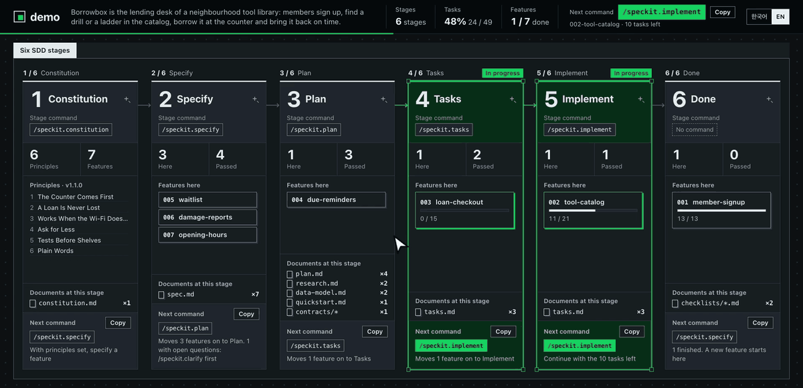

# spec-visualizer

English | [한국어](README.ko.md)

A local, read-only dashboard for a [GitHub spec-kit](https://github.com/github/spec-kit) project.
It lays the six spec-driven stages out on one board, shows which feature stands where and what to type next, and turns every spec document into a page that fits its kind, instead of plain rendered markdown.



## Install

Node.js 20 or later.

```sh
npx spec-visualizer            # the spec-kit project in the current folder
npx spec-visualizer --demo     # a bundled example project, to look around
```

It prints the address (`http://127.0.0.1:4321` by default) and opens it in your browser. The folder must contain `specs/` or `.specify/`.

### Claude Code plugin

The plugin starts, opens and stops the same dashboard from a Claude Code session. In Claude Code:

```text
/plugin marketplace add josephleee/spec-visualizer
/plugin install spec-visualizer@spec-visualizer
```

From a shell, `claude plugin install spec-visualizer --marketplace josephleee/spec-visualizer` does both.

Then run `/spec-visualizer:dashboard` in a spec-kit project (`/spec-visualizer:dashboard stop` to stop it), or ask Claude to show the spec status.

## Usage

```sh
spec-visualizer [path] [options]
```

Without a path it uses the current folder. The page updates by itself when files change. The UI is in Korean or English (the switch at the right of the top strip), and follows the system light or dark setting.

| Option | Default | Meaning |
|---|---|---|
| `--port <n>` | `4321` | Port to listen on. Without this option, a taken port moves on to the next free one (up to 4330). With it, a taken port is an error. |
| `--demo` | | Show the bundled example project (`examples/demo`) instead of a path. |
| `--no-open` | | Do not open the browser. It is also not opened when the output is not a terminal. |
| `--help`, `--version` | | Print the usage or the version. |

## The board

The first screen is one board with six stage cards: Constitution, Specify, Plan, Tasks, Implement, Done. Each card shows the stage's command, how many features stand there and how many have passed, the features standing there as links, the documents the stage leaves, and the next command for those features with a copy button. The Constitution card lists the principles. A stage holding a feature with unfinished tasks is drawn in green.

The dark strip above it names the project (with the first paragraph of its `README.md`), the share of tasks done, the features finished and the next command for the feature in progress.

A feature whose documents are new or changed since you last opened them carries a mark. The marks are kept in your browser's local storage, per project folder. The first time a project is opened, every document counts as already seen.

## Stage pages

Clicking a card or a feature zooms into that stage's document (`#/stage/<stage>/<feature>`). The bar on top goes back to the board, jumps between the six stages and switches the feature; the index on the left follows the section you are reading. If the feature has not reached the stage yet, the page says where the feature is and which command creates the document.

| Stage | File | Shown as |
|---|---|---|
| 1 Constitution | `.specify/memory/constitution.md` | Numbered principle plates; version, ratified and amended dates; field sheets |
| 2 Specify | `specs/<feature>/spec.md` | Counts, user stories with priority and narrative, each scenario as Given → When → Then, requirement groups with a size bar, success criteria, open questions (`NEEDS CLARIFICATION`) |
| 3 Plan | `specs/<feature>/plan.md` | Summary, Technical Context as a sheet of fields, tables as tables, trees as code |
| | `research.md` | Each decision beside the alternatives it rejected |
| | `data-model.md` | Entity cards |
| | `quickstart.md` | Its sections as numbered steps |
| | `contracts/*` | Markdown for `.md`, a code view for anything else |
| 4 Tasks | `specs/<feature>/tasks.md` | Structure: phases, one mark per task (filled = done, outline = open), parallel `[P]` tasks stacked, story tags, the task text on demand |
| 5 Implement | the same `tasks.md` | Progress: done of total, every task as a cell, what is left per phase and per story, the next command |
| 6 Done | `specs/<feature>/checklists/*.md` | Items by group with counts; a chooser when there are several checklists |

Any other `.md` in a feature folder is an `other` document: it is linked from the feature's pages and shown section by section (`#/doc/<path>`). Outside `contracts/`, only `.md` files are read.

## How it reads your documents

The server reads each document with a markdown parser and turns the parts it recognises (user stories, scenarios, requirement lists, task phases, labelled fields, decisions, entities) into typed blocks; the browser draws those blocks. No AI is involved, so a page always shows what the file says now.

Nothing is dropped: a part that does not match a rule is kept as markdown, parts a page does not draw are listed under a disclosure at its end, and a document that does not follow the template is shown in its own order. HTML comments are the one exception; they are hidden.

The exact rules per document type are in [docs/parsing-rules.md](docs/parsing-rules.md) (Korean). The design of the whole tool is in [docs/design.md](docs/design.md) (Korean).

## Security

- **Local only.** The server listens on `127.0.0.1` and answers only requests whose `Host` is `127.0.0.1:<port>` or `localhost:<port>`.
- **Read-only.** It never writes to the project it shows, and accepts only `GET` requests.
- **Only what the scan found.** A document is served only if the scan of `specs/` and `.specify/` listed it. Symbolic links are not followed.
- **Document content is untrusted.** Raw HTML inside markdown is shown as text, never run. Images are not loaded: their alt text and address are shown instead. Only `http`, `https` and `#` links can be followed.

## What it does not do

- Edit documents or tick checkboxes
- Highlight what changed inside an updated document
- Read other formats (OpenSpec, Kiro and so on)
- Show several projects at once
- Generate pages with AI
- Export static HTML, host the dashboard or log users in
- Draw entity relationships as a graph

## Development

Use Node.js 24 or later: it runs the TypeScript sources directly.

```sh
git clone https://github.com/josephleee/spec-visualizer.git
cd spec-visualizer
npm install
npm test              # vitest
npx tsc --noEmit      # type check
npm run build         # web files into dist/web, the server as JavaScript into dist/server
npm start -- --demo   # run from the TypeScript sources; needs the web files from one `npm run build`
npm start -- <path>   # the same, for a project of your own
```

`npm run dev` serves the web sources with Vite and passes `/api` on to a server running on port 4321.

The published package runs `dist/server/cli.js` and contains `dist/server`, `dist/web` and `examples/demo`. The Claude Code plugin is in `plugin/`, and `.claude-plugin/marketplace.json` makes this repository its marketplace. Changes are listed in [CHANGELOG.md](CHANGELOG.md).

## License

[MIT](LICENSE)
