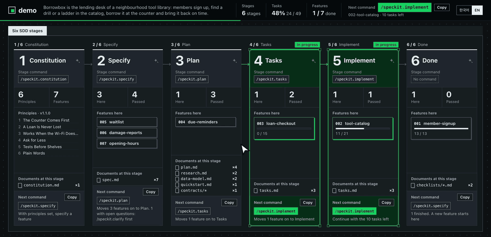

# spec-visualizer

[English](README.md) | [한국어](README.ko.md) | 简体中文

面向 [GitHub spec-kit](https://github.com/github/spec-kit) 项目的本地只读仪表盘。
它把规范驱动开发的六个阶段摆在一块看板上，显示每个功能处于哪个阶段、下一步该输入什么命令，并把每份规范文档画成适合其类型的页面，而不是直接渲染 markdown。



## 安装

需要 Node.js 20 或更高版本。

```sh
npx spec-visualizer            # 当前文件夹中的 spec-kit 项目
npx spec-visualizer --demo     # 内置的示例项目，用来先看看
```

它会打印地址（默认是 `http://127.0.0.1:4321`）并在浏览器中打开。文件夹中必须有 `specs/` 或 `.specify/`。

### Claude Code 插件

插件可以在 Claude Code 会话中启动、打开和停止同一个仪表盘。在 Claude Code 中输入：

```text
/plugin marketplace add josephleee/spec-visualizer
/plugin install spec-visualizer@spec-visualizer
```

在终端中，`claude plugin install spec-visualizer --marketplace josephleee/spec-visualizer` 可以一步完成。

然后在 spec-kit 项目中运行 `/spec-visualizer:dashboard`（用 `/spec-visualizer:dashboard stop` 停止），或者直接让 Claude 显示规范进度。

## 用法

```sh
spec-visualizer [path] [options]
```

不给路径时使用当前文件夹。文件变化时页面会自动更新。界面语言是韩语或英语（顶部栏右侧的开关），目前没有中文界面；明暗主题跟随系统设置。

| 选项 | 默认值 | 含义 |
|---|---|---|
| `--port <n>` | `4321` | 监听端口。不指定时，端口被占用会顺延到下一个空闲端口（最多到 4330）。指定时，端口被占用会报错。 |
| `--demo` | | 显示内置示例项目（`examples/demo`），不需要路径。 |
| `--no-open` | | 不打开浏览器。输出不是终端时也不会打开。 |
| `--help`、`--version` | | 打印用法或版本。 |

## 看板

第一个画面是一块看板，上面有六张阶段卡片：Constitution、Specify、Plan、Tasks、Implement、Done。每张卡片显示该阶段的命令、停在这里的功能数量和已经通过的功能数量、停在这里的功能（可点击）、该阶段产生的文档，以及这些功能的下一条命令和复制按钮。Constitution 卡片列出原则。如果某个阶段有任务尚未完成的功能，该阶段用绿色标出。

看板上方的深色栏显示项目名称（以及项目 `README.md` 的第一段）、任务完成比例、已完成的功能数量，以及进行中功能的下一条命令。

如果某个功能的文档自上次打开后是新增的或有改动，该功能会带一个标记。标记保存在浏览器的本地存储中，按项目文件夹区分。第一次打开一个项目时，所有文档都算作已读。

## 阶段页面

点击卡片或功能会放大进入该阶段的文档（`#/stage/<stage>/<feature>`）。顶部的栏可以回到看板、在六个阶段之间跳转、切换功能；左侧的目录跟随你正在阅读的小节。如果功能还没有到达该阶段，页面会说明功能目前在哪里，以及用哪条命令创建该文档。

| 阶段 | 文件 | 显示方式 |
|---|---|---|
| 1 Constitution | `.specify/memory/constitution.md` | 带编号的原则牌；版本、批准日期和修订日期；字段表 |
| 2 Specify | `specs/<feature>/spec.md` | 各项计数、带优先级和叙述的用户故事、每个场景画成 Given → When → Then、带长度条的需求分组、成功标准、待澄清问题（`NEEDS CLARIFICATION`） |
| 3 Plan | `specs/<feature>/plan.md` | 摘要、Technical Context 字段表、表格按表格画、目录树按代码画 |
| | `research.md` | 每个决定与被否决的备选方案并排 |
| | `data-model.md` | 实体卡片 |
| | `quickstart.md` | 各小节作为带编号的步骤 |
| | `contracts/*` | `.md` 按 markdown 显示，其他文件按代码显示 |
| 4 Tasks | `specs/<feature>/tasks.md` | 结构：阶段、每个任务一个标记（实心 = 完成，空心 = 未完成）、可并行的 `[P]` 任务叠放、故事标签、按需展开任务文字 |
| 5 Implement | 同一个 `tasks.md` | 进度：已完成数与总数、每个任务一个格子、按阶段和按故事统计剩余、下一条命令 |
| 6 Done | `specs/<feature>/checklists/*.md` | 按分组列出条目和计数；有多个检查清单时可以选择 |

功能文件夹中的其他 `.md` 文件算作 `other` 文档：功能页面上有链接，按小节显示（`#/doc/<path>`）。除 `contracts/` 外，只读取 `.md` 文件。

## 它如何读取你的文档

服务器用 markdown 解析器读取每份文档，把能识别的部分（用户故事、场景、需求列表、任务阶段、带标签的字段、决定、实体）变成带类型的块；浏览器负责把这些块画出来。整个过程不使用 AI，所以页面显示的始终是文件当前的内容。

内容不会被丢弃：不符合规则的部分按 markdown 保留，页面没有画出的部分列在页面末尾的折叠区里，不按模板写的文档按它自己的顺序显示。唯一的例外是 HTML 注释，它们会被隐藏。

每种文档类型的具体规则见 [docs/parsing-rules.md](docs/parsing-rules.md)（韩语）。整个工具的设计见 [docs/design.md](docs/design.md)（韩语）。

## 安全

- **仅限本地。** 服务器监听 `127.0.0.1`，只响应 `Host` 为 `127.0.0.1:<port>` 或 `localhost:<port>` 的请求。
- **只读。** 它从不写入所显示的项目，只接受 `GET` 请求。
- **只提供扫描到的内容。** 只有在扫描 `specs/` 和 `.specify/` 时列出的文档才会被提供。不跟随符号链接。
- **文档内容不可信。** markdown 中的原始 HTML 作为文字显示，绝不执行。图片不会加载，只显示其替代文字和地址。只有 `http`、`https` 和 `#` 链接可以点击。

## 它不做的事

- 编辑文档或勾选复选框
- 高亮显示文档更新后具体改了什么
- 读取其他格式（OpenSpec、Kiro 等）
- 同时显示多个项目
- 用 AI 生成页面
- 导出静态 HTML、托管仪表盘或用户登录
- 把实体关系画成图

## 开发

使用 Node.js 24 或更高版本：它可以直接运行 TypeScript 源码。

```sh
git clone https://github.com/josephleee/spec-visualizer.git
cd spec-visualizer
npm install
npm test              # vitest
npx tsc --noEmit      # 类型检查
npm run build         # 网页文件输出到 dist/web，服务器编译为 JavaScript 输出到 dist/server
npm start -- --demo   # 从 TypeScript 源码运行；需要先执行一次 `npm run build` 生成网页文件
npm start -- <path>   # 同上，用于你自己的项目
```

`npm run dev` 用 Vite 提供网页源码，并把 `/api` 转发到运行在 4321 端口的服务器。

发布的包运行 `dist/server/cli.js`，包含 `dist/server`、`dist/web` 和 `examples/demo`。Claude Code 插件在 `plugin/` 中，`.claude-plugin/marketplace.json` 让本仓库成为它的插件市场。变更记录见 [CHANGELOG.md](CHANGELOG.md)。

## 许可证

[MIT](LICENSE)

## 参与贡献

构建和测试方法见 [CONTRIBUTING.md](CONTRIBUTING.md)，漏洞报告见 [SECURITY.md](SECURITY.md)，版本规则见 [RELEASING.md](RELEASING.md)，变更记录见 [CHANGELOG.md](CHANGELOG.md)。
