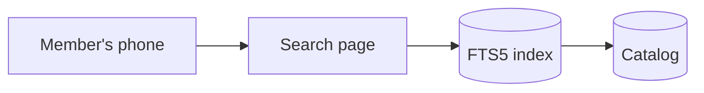

# Design Document: Tool search

## Overview

A full-text index in the existing SQLite database, queried as the member types.

## Architecture

## Correctness Properties

### Property 1: Every tool is findable by its own name

For any tool in the catalog, searching for its full name returns that tool.

**Validates: Requirements 1.1**

### Property 2: Case and accents do not matter

For any query, changing letter case or adding accents returns the same tools.

**Validates: Requirements 1.2**

## Testing Strategy

Property tests generate tool names with accents and mixed case.
