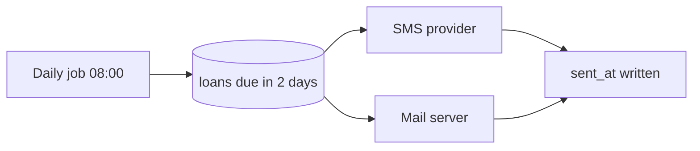

# Design: Add due reminders

## Context

The server already runs a nightly backup at 02:00. There is no queue and no other scheduled work.

## Goals / Non-Goals

**Goals:**
- At most one reminder per loan.
- Nothing is sent at night.

**Non-Goals:**
- Reminders after the due date (the overdue list covers those).

## Decisions

### Decision: One daily job at 08:00
A single pass over loans due in two days. Running more often would only matter for loans made after 08:00 that are due in two days, which the next morning's pass still catches one day ahead.

### Decision: A sent-at column instead of a queue
Each loan records when its reminder went out. The job skips loans that already have one, so a rerun after a crash sends nothing twice.

## Data Flow

## Risks / Trade-offs

- The SMS provider costs money per message; the library's budget allows about 300 a month.
